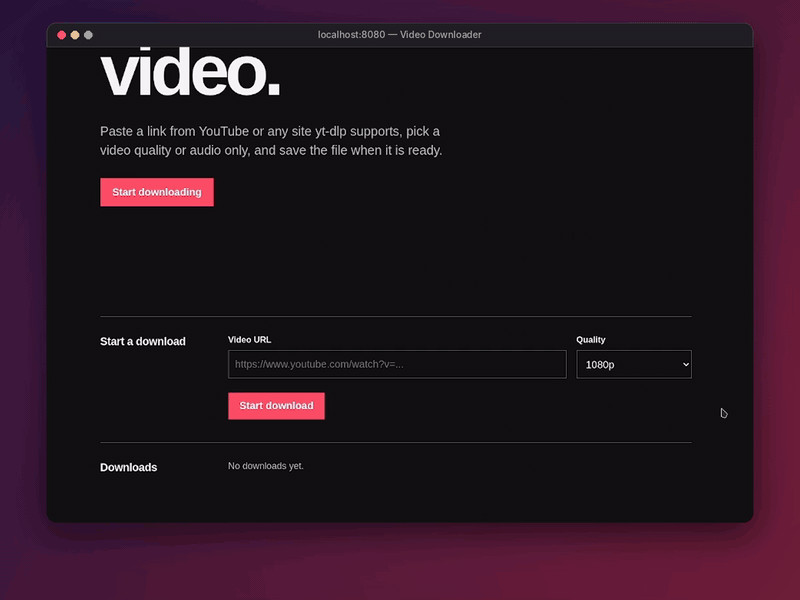

# Video Downloader

An asynchronous video downloader built with Node.js, Express, TypeScript, PostgreSQL, and yt-dlp. The React and TypeScript web interface starts downloads and tracks their progress. FFmpeg combines video and audio, and Prometheus collects application metrics.



## Features

- Download videos from YouTube and other sites supported by yt-dlp
- Select 360p, 720p, or 1080p video, or audio only as MP3
- Watch download progress live
- Process downloads in the background with yt-dlp child processes, two at a time
- Store download jobs in PostgreSQL
- Start downloads, watch their status, and save files from a one-page React interface
- Expose Prometheus metrics at `/metrics`
- Run the app with Docker Compose

## Installation

### Using Docker

Build and start the application:

```bash
docker compose up --build
```

Open **http://localhost:8080**. No `.env` file or database migration command is required for the default Docker setup.

The PostgreSQL data and downloaded files persist in Docker volumes. Stop the application with Ctrl+C.
